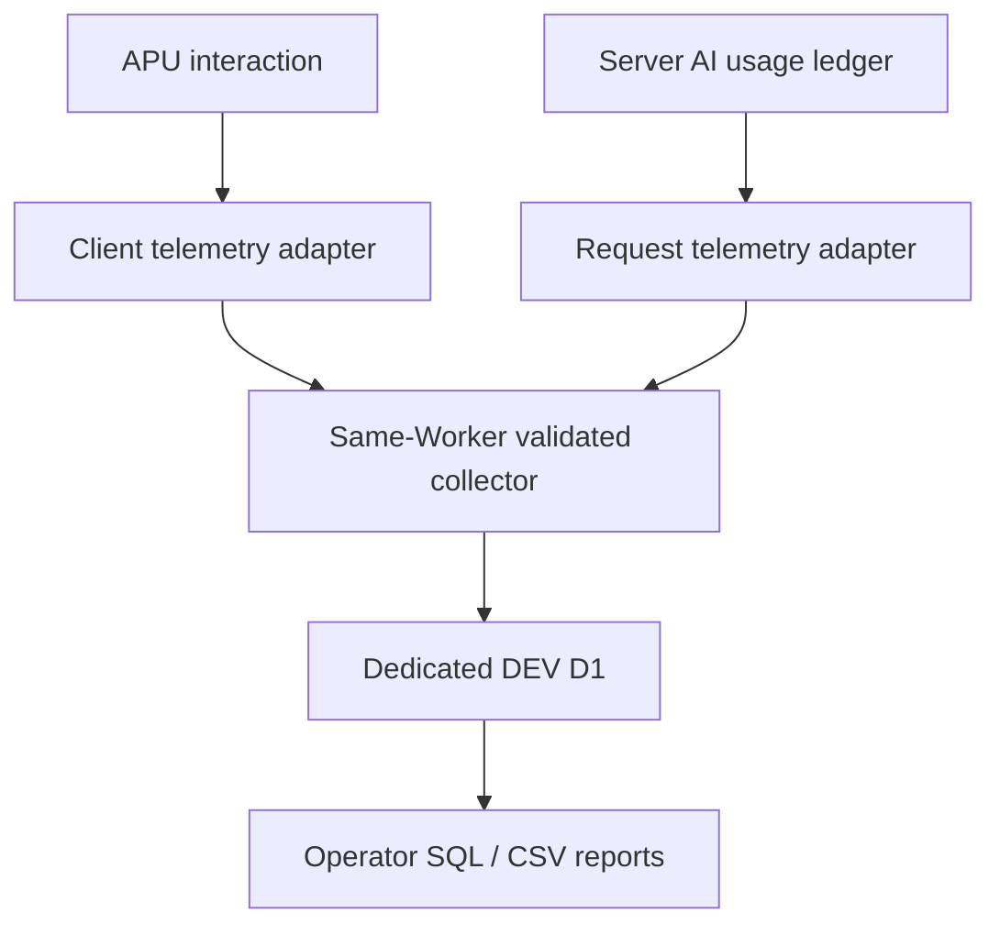

# TELEMETRY_ARCHITECTURE

Status: proposed DEV-only v1; **not implemented or provisioned**. Decision basis: [audit](TELEMETRY_INFRA_AUDIT.md), source `fc8ac5520b7b49b442bedc47558c73f20ce2bea6`. Measurement authority: [specification](PILOT_TELEMETRY_SPEC.md).

## 1. Decision and alternatives

Use **the existing standalone DEV Worker + a small telemetry adapter/collector + dedicated DEV D1**, reusing the existing server AI usage ledger. D1 is selected after comparing the audited persistence rather than assumed by default. No external host, analytics vendor, queue, event bus, dashboard application or business database migration is needed.

Ratings: L/M/H = implementation/operating burden; reliability is relative to exact small-pilot joins and costs, not universal service reliability.

| Option | Implementation / APU fit | Cost / minimization | Measurement and export | Decision |
| --- | --- | --- | --- | --- |
| Existing request ledger + diagnostic Session JSON only | L; already exists | Lowest; JSON contains disallowed content if reused whole | Voluntary developer-only export; misses testers, crashes and abandoned sessions; no activity baseline | Useful local comparison fixture, insufficient primary store |
| Existing business persistence | No active app database found; D1 stub only | Reuse advantage unproven | No existing schema/store to extend | Reject assumption; do not activate business DB |
| DEV LOG KV | M; same Worker but unrelated ownership | Low at tiny scale; Free write allowance restrictive | Append keys/listing/export/dedup and exact concurrent totals need custom work; eventual consistency | Keep for DEV LOG, do not repurpose |
| Dedicated D1 | M; native binding/types already available | Low; isolated retention and EU DB jurisdiction possible | SQL uniqueness, exact call rows, cohort/session/workflow joins, SQL/CSV export | **Recommend** |
| Analytics Engine | L ingest / M reporting | Low, but billing status provisional; residency not verified | Sampling, fixed retention and limited primary-ledger semantics complicate exact paths/cost completeness | Possible later aggregate sink, omit v1 |
| R2 objects / manual uploads | M; no active R2 binding | Low bulk storage, extra resource | Must build indexing, dedup and query layer | No simplicity gain |
| External SaaS/DB, new Durable Object/Queue | H new lifecycle/integration | New processor/resource and operational obligations | Could improve specialized delivery but unnecessary for expected pilot | Defer unless measured loss/load proves need |

## 2. Boundaries and module ownership

Suggested repository-native boundaries (new module names may be adjusted locally without changing contracts):

- `app/telemetry/contract.ts`: strict envelope/event validators, enums, measurement version; no React, provider or storage imports.
- `app/telemetry/client.ts`: in-memory context/queue, activity clock, event emission. No pedagogical state serialization and no persistent browser participant ID.
- `app/telemetry/server.ts`: opt-in/eligibility, existing-identity pseudonym derivation, signed context validation, server-owned envelope fields, fixed health codes.
- `app/telemetry/store.ts` plus `app/telemetry/d1-store.ts`: small explicit insert/upsert/query interface; no generic event bus.
- `app/telemetry/model-usage-adapter.ts`: whitelist projection from existing ledger, pending/final monotonic state, request context and contained failures.
- `app/api/telemetry/context/route.ts` and `app/api/telemetry/events/route.ts`: same origin, existing `getAccessIdentity`, no authentication-policy changes.
- `telemetry/migrations/`, `telemetry/reports/`, `scripts/telemetry/`: telemetry-only SQL, bounded local reporting/export/retention tools. Keep empty business `db/schema.ts` and `getDb()` untouched.

APU emits semantic events at supported actions/commits. Telemetry never owns notebook/analysis/output state, phase transitions, saved projects, price selection or provider retry decisions. Adapter failures cannot modify a pedagogical result. UI component reorganization changes only local emitters; persisted schema and report definitions remain stable. No component-name or CSS-selector event naming.

## 3. Identity, enrollment and session context

### Proposed participant identity (G2)

The existing auth validator exposes no opaque subject ID; it returns a normalized validated email and role. Within a separate telemetry adapter derive:

`participant_id = base64url(HMAC-SHA256(TELEMETRY_PSEUDONYM_KEY, cohort_id + "\\0" + normalized_existing_identity))`.

The email is consumed only from the existing validated in-memory identity; it is **not copied to telemetry storage, events, exports, client context, logs or a mapping table**. Do not add email/JWT/sub claims to authentication. A plain email hash is unacceptable because the space is enumerable. Store `cohort_id` and `key_version`; keep one cohort key stable for the pilot. Rotation starts a documented linkage break/new cohort; no silent historical merge. Different cohorts must not share a pseudonym. Pseudonym key and context-signing key are distinct secrets; no values are supplied by this package.

This is pseudonymization, **not anonymity**. Existing authenticated identity is still processed for a new purpose and the controller can recompute a pseudonym. Gate G2 explicitly approves that narrow use; if disallowed, disable stable participant linkage and mark U02/U03/U05 unavailable rather than inventing a fingerprint. Do not silently substitute persistent cookies/localStorage, browser fingerprint, IP, account email or a client-selected participant UUID.

Eligibility uses an operator-maintained allowlist of participant HMACs for the cohort and existing tester role. It does not grant access, change roles or provision users. An empty/missing allowlist disables real collection. Development/operator and synthetic contexts are labeled separately and excluded by default; synthetic fixtures use generated identities only. Enrollment and opt-in completion must precede writing participant-linked telemetry.

### Context handshake

1. When disabled or ineligible, adapter is a no-op: no telemetry context/write, no browser tracking persistence, no new collection requests.
2. Existing auth remains necessary. After the user receives the approved notice and explicitly opts in for this tab visit, `POST /api/telemetry/context` creates a server session. Opt-in evidence records notice version and server time; do not treat a request flag alone as proof of ethically valid consent without the approved UI/process.
3. Return an opaque signed context token, random session ID, server time anchor, monotonic-anchor protocol parameters, measurement version and policy flags. Participant ID need not be returned to the browser. Token contains/commits to server-side cohort, session, HMAC subject, issue/expiry and key version; keep it in memory only, never URL/storage/logs.
4. Context token is additional telemetry context, **not an authentication credential**: every collector/AI request still validates Access as before; token subject must match that identity. It cannot authorize application operations. Require exact same-origin requests and JSON; reject cross-origin origin/header use; no wildcard CORS. Context responses are private/no-store.
5. Attach bounded telemetry context/operation headers to existing AI API requests. Invalid/missing telemetry context cannot block otherwise valid APU work; skip association and expose fixed telemetry health status where appropriate. Never accept client price/token data to repair missing context.
6. New tab/reload gets a new session. Thirty-minute real inactivity rotates at next interaction/request; AI started before the boundary remains in its original session. Heartbeats cannot keep a session alive. Token maximum lifetime 12 hours; renewal after expiry uses a new session. Logout/identity uncertainty immediately stops client tracking/flush; pending authorized server calls retain their original scope.

Session state stores last genuine interaction/request time, not just heartbeat receive time. Client intervals carry monotonic last-interaction offset so a periodic timer cannot masquerade as renewed user activity. Client activity is necessarily an estimate and can be falsified by a modified browser; use it for pilot analytics, not billing or access decisions.

No persistent analytics cookie/localStorage is introduced. A per-visit consent prompt adds friction but is the smallest default consent mechanism without persistent tracking. A future remembered-consent preference would require its own device-storage analysis and expiry design.

## 4. Storage contract and integrity

Three logical tables suffice; SQL migrations are authored during B1, not executed remotely by the audit:

| Table | Keys / purpose | Constraints and indexes |
| --- | --- | --- |
| `telemetry_sessions` | server session ID, pseudonym, cohort, role/test class, consent/notice/measurement/key versions, opened/last interaction/expiry times | No email/IP/JWT; session ownership immutable. Index cohort/opened_at and participant/opened_at. |
| `telemetry_events` | unique event ID, session/workflow/tab IDs, client sequence, timestamps, event/measurement versions, phase and strict typed payload | UUID key; uniqueness `(session_id,tab_id,client_seq)`; session relationship; event/time and workflow/time indexes only as reports require. No generic JSON bag. |
| `telemetry_ai_calls` | unique server call ID and safe ledger projection, operation/session/workflow association, pending/final state, pricing snapshot | Session/workflow+started time indexes; immutable identity check; terminal update monotonic. No repeated event rows storing the same cost. |

Workflow summaries are derived from WS/DOC/RESET and AI joins, not another mutable business state table. Missing workflow-start event leaves an explicitly partial episode. Server AI can retain a valid UUID workflow association even if its start event was lost; conversion reports exclude/label partial episodes. Keep SQL parameterized and bounds enforced in both adapter and collector. Migration version and report version are explicit.

Deduplication: same ID/sequence and identical immutable identity is idempotent; conflicting ID or reused sequence with a different event is rejected with fixed conflict code. Do not return success for a conflicting body. Validate entire batch before transaction; ≤20 events and ≤32KiB total request; per-event limit 2KiB. Unknown fields/versions/negative times/oversized UUIDs/client server-event claims fail closed. Normal duplicates return acknowledged IDs without double counting. Do not persist raw rejected bodies.

Use one short atomic D1 batch/transaction for validated event insertion and necessary session update. Preaggregate AI calls before joining general events. A late pending insert cannot overwrite a finalized call. A later terminal row with conflicting immutable identity is a quality conflict; it cannot silently rewrite another participant/session.

Bound ingestion abuse without collecting IP: enforce an atomic per-session budget of 120 submitted events/minute, including duplicates, plus at most 30 context creations/hour per eligible pseudonym. Normal activity uses four intervals/minute; excess returns fixed 429/backoff with no payload logging. Store budget counters with the existing session update rather than another global hot counter; context-rate checks use the participant/time index. Enrollment, request-size limits and an operator kill switch bound the small pilot; this is not a general DDoS platform. Include budget-update writes in capacity estimates and test that overload affects collection only. Do not change Access/WAF configuration as part of this feature.

## 5. Reliable enough delivery, without another infrastructure layer

Client queue is memory-only, max 100 events, max age two minutes; batch every 15 seconds during activity and immediately on semantic boundaries when reasonable. Retry only network/5xx/429 transient ingest failures, max two retries with jitter/backoff bounded by age; same IDs on retry. Do not retry invalid schema/401 or prompt reauthentication through telemetry. Drop oldest expired events with fixed health count. `fetch(...,keepalive:true)` at visibility exit is best effort, not durable delivery. Avoid a second offline database, localStorage queue or infinite retries.

Server adapter composes the existing request collector; records remain available for current developer UI independently. Persist pending before provider invocation on a bounded best-effort path; at most 100ms added blocking budget per lifecycle write. Do not let a rejected/timed-out sink throw into `runInstrumentedModelCall` or change AI result. Preserve the underlying write promise only through request-scoped execution lifetime (`ExecutionContext.waitUntil` or the existing runtime-supported equivalent); never store it, identity or context in a Worker-global variable. Terminal completion uses the same request lifetime, including streaming MAIN. B1/B2 must prove the exact Vinext request-lifetime mechanism in the pinned runtime with a small integration test; do not invent a global context bridge.

Promise timeout does not cancel a D1 write. Late writes are safe because IDs and state updates are idempotent/monotonic. No automatic AI retry is added. If request-lifetime integration cannot be made request-scoped, stop that adapter substep and report the specific gap; other contract/report work can continue. A bounded awaited sink with explicit measured latency can be considered in a subsequent decision, not silently substituted.

There is no exactly-once guarantee between provider invocation and database storage. A crash may lose even the pending event. A pending record can signal unknown charge; it cannot recover provider usage. Reports show observed lower bounds, missing finalizations, collection-health counters and synthetic expected/stored reconciliation. A live complete cost total means complete **for observed calls**, not proof the cloud never lost a call. Do not solve this with a queue/DO unless pilot verification demonstrates material loss. Capture fixed server health counters/return metadata, not pedagogical payloads or user identifiers in console logs.

Session/activity clocks: handshake binds a server anchor to tab monotonic elapsed time. Validate bounded receive delay (two minutes) and >5s clock inconsistency; flag/reject unsuitable intervals rather than assigning them to a wrong day. Split at visibility/focus/idle/phase boundaries, cap to real intervals, and reset after suspend. Participant totals merge overlapping intervals across tabs. Device clock edits cannot create arbitrary active time. Dictation/passive reading are only partially covered by interaction proxy; no microphone or content instrumentation is added.

## 6. AI economics and integration map

Use `createRequestUsageCollector` with an optional safe persistence callback. Request adapters are created **after existing auth validation** for `/extract`, `/chat`, `/analysis`, `/need-route`, `/f2`, `/f3`; `quest-controller` inherits the same request collector. One request may contain multiple calls, each with its own `call_id`. MAIN streaming uses its existing `createInstrumentedModelCallLifecycle`, not a separate fetch patch or second ledger.

Pass operation instance IDs (new random UUIDs per explicit action), prior-operation IDs for user retry/regeneration, and server retry/fallback linkage for actual secondary provider attempts. The grounding rescue in `/extract` is a fallback, not a duplicate user action. Keep server-generated request/call identity authoritative; don't change existing business turn IDs or schema merely for telemetry.

Telemetry prices are existing ledger snapshots. Add only coverage/regime/version metadata needed to report incomplete estimates. If supported pricing behavior changes, update the existing authority and its tests, not telemetry rate constants. Before launch validate a provider-backed controlled sample only under separate authorization; no new API key or paid request is authorized by source implementation batches.

Client emitters observe:

- successful explicit runtime transitions, including returns from F3 to F2;
- `resetCurrentProject` as workflow reset, without inheriting its diagnostic session rotation;
- `commitBuildDocument`/accepted source and `enterF3` for usable baseline completion;
- `renderF3` only after successful `acceptF3Render`; stale/boundary/failed results are not accepted outputs;
- explicit F2 local-only reconciliation as an operation with no AI calls;
- operation intent before supported extraction/chat/F2/F3 requests; obsolete continuations can record `stale_discarded` while their incurred server AI cost remains.

No new event is emitted merely because React rerenders, a panel opens, a state effect replays, or a retained output is revisited.

## 7. DEV-only enablement and configuration

Proposed names: `APU_TELEMETRY_ENABLED=0` default, `APU_TELEMETRY_ENV=dev`, `APU_TELEMETRY_COHORT`, `APU_TELEMETRY_METADATA_ENABLED=0`, dedicated `TELEMETRY_DB`, pseudonym/context secret names and eligible participant HMAC set. No values are embedded in repository prompts. Cohort/token/policy configuration is versioned.

Require positive DEV environment marker, explicit expected DEV hostname, opt-in and eligible cohort before collection. Host is a safety condition in a known deployed Worker, not an auth mechanism. Missing/invalid binding/key/config fails to no-op collection and visible fixed readiness error to the operator; application flow stays usable. Local tests explicitly use synthetic mode/emulated storage. No automatic derivation from branch names or `NODE_ENV=production` because hosted DEV also uses production build mode.

Extend `wrangler.dev.json` and `ops/dev/prepare-worker.mjs` during B1 with **optional disabled telemetry inputs**. Absent telemetry must produce the preexisting config; enabled future DEV configuration requires a dedicated DB identity and isolation evidence. Preserve exact key validation for unrelated fields. No change to `wrangler.jsonc`, old PR60 guard, deployment workflow, default `npm run deploy`, Access policy or production resources. Do not invoke deploy commands or remote migration during code batches.

## 8. Reporting, retention and deletion

Use operator-controlled SQL and local CSV generation first. No new HTTP admin/export endpoint or dashboard. Parameterize cohort/date windows; default exclude developer/synthetic. Raw SQL export stays restricted to operator; shared CSV defaults to aggregates and suppresses small cells. Reports include sample/coverage/measurement versions and distinguish baseline output from generated material.

Proposed base retention: **30 rolling days of raw events/AI/session pseudonyms**; optional aggregate retention 180 days only after review and sufficiently coarse aggregation. Retention operates on event/call dates, not indefinitely on last session update. Operator runs the checked retention command daily during collection; require an assigned owner and recorded schedule before launch. Do not create an automation in this audit. At first scale increase, a same-Worker scheduled cleanup may replace manual operation through its own authorized change.

SQL/CSV exports expire after seven days unless the controller documents a different justified period. Participant deletion derives the same HMAC under retained cohort key version and deletes related sessions/events/calls transactionally; no email mapping table. Retain a minimal restricted deletion ledger/tombstone outside shared reports as required for replay after restore, under approved controller procedure. Backup history can persist 7/30 days by plan; restored data must have retention/deletion replayed before reporting. Do not promise instantaneous erasure from provider backups. Include incomplete/left-truncated observation handling after retention.

## 9. Privacy gates — no automatic compliance claim

The telemetry dataset is personal data when linked to a participant pseudonym. Small cohorts, exact times, repeated behavior and route choices can reveal a teacher or infer sensitive classroom circumstances. Broad content category labels can still relate to identifiable children. Hashing content does not make it safe.

Before real collection, the responsible controller must record:

1. Purpose, controller/processor roles, applicable legal basis, recipients, notice, retention, rights/deletion channel and whether a DPIA is needed. Do not characterize pilot consent as automatically valid in an employment/education power relationship.
2. Approval of the transient existing-identity HMAC use and cohort eligibility. No raw identifiers in telemetry; no staff-performance ranking or child tracking.
3. Device-storage/ePrivacy analysis separate from GDPR basis. ÚOOÚ [PR1 in audit] requires prior demonstrable consent for nontechnical cookies/similar technologies; reusing a necessary auth cookie for another purpose is not automatically exempt. Memory-only analytics avoids adding a persistent browser ID but does not remove all legal analysis of client tracking.
4. Approved per-visit voluntary opt-in flow, equally usable app after refusal, stop/revocation behavior and proof/version of the notice. No collection before opt-in or after stop; stopping does not silently imply retrospective deletion, whose process is separately available.
5. Cloudflare/provider agreements, international access/processing and current log retention. D1 EU jurisdiction alone does not constrain global Worker, Access, edge logs or OpenAI processing. Application telemetry must never copy IP/country/user agent/headers; platform processing/logging must be reviewed separately.
6. Export recipients/access and small-cell review. Optional G3 route/format metadata must be justified; situation/need/goal text and extra AI classification remain off.

These are activation conditions, not a declaration of GDPR compliance or a redesign of APU authentication. If gates cannot be met, keep collection disabled; preserve synthetic validation capability and report the affected P0 metrics unavailable.
